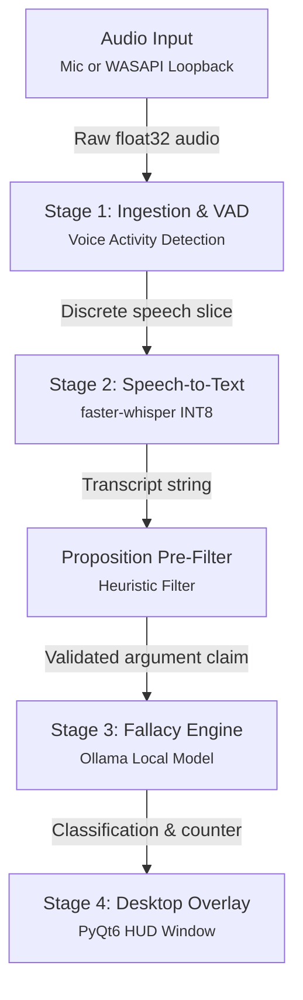

# System architecture

This document outlines the internal pipeline, data flow, threading structure, and error handling for Elenchus.

---

## Pipeline overview

Elenchus breaks speech analysis into four decoupled stages running entirely on local CPU and GPU cores without network calls:

### Data flow and stage handoffs

Here is how audio and text move through volatile memory:

- **Input to Stage 1**: Incoming audio arrives in 16 kHz mono chunks from PortAudio or WASAPI loopback. The VAD calculates root-mean-square (RMS) energy to separate deliberate speech from background room noise.
- **Stage 1 to Stage 2**: When silence is detected (or push-to-talk is released), the accumulated speech slice in RAM is dispatched directly to the `faster-whisper` worker thread.
- **Stage 2 to Stage 3 (The Proposition Pre-Filter)**: Transcribing speech is not enough. People pause, cough, repeat words, and make conversational interjections. The heuristic filter evaluates whether the transcript forms a complete claim before sending it to the LLM. If the text is conversational noise, it gets discarded. This prevents the model from hallucinating fallacies on throat-clearing.
- **Stage 3 to Stage 4**: When a complete claim exists, the local model checks for formal and informal fallacies. It returns an explanation and a counter-argument under 30 words.
- **At Stage 4**: The PyQt6 HUD receives a thread-safe Qt signal with the verdict, the counter-argument, and the latency telemetry, displaying it in your peripheral field of view.

---

## Processing stages

### Stage 1: Audio ingestion and voice activity detection

Implemented in `core.audio_capture` and `core.vad`.

The recorder captures raw float32 audio at 16 kHz mono from default microphones or loopback streams (WASAPI on Windows, PulseAudio or PipeWire monitor on Linux). Voice activity detection supports two styles: manual push-to-talk and continuous RMS energy tracking with a rolling noise floor.

Audio arrays remain strictly in volatile RAM. Nothing is ever written to disk.

### Stage 2: Quantized speech recognition

Implemented in `core.transcriber`.

Speech recognition runs on `faster-whisper` using the `base.en` model quantized to INT8. It runs across 4 CPU threads with a beam size of 1 to keep latency minimal. The transcriber cleans up repeated words, silence padding, and coughing in quick bursts under 500 ms.

### Stage 3: Fallacy classification

Implemented in `core.llm_client`.

Classification relies on a local Ollama daemon running lightweight quantized reasoning models, defaulting to `qwen2.5-coder:3b`.

Before sending text to the model, an argument proposition filter evaluates whether the transcript forms a complete claim. If the speaker paused mid-sentence, cleared their throat, or uttered filler words, the pipeline discards the text. When a genuine claim arrives, the model identifies any formal or informal fallacy and returns a counter-argument under 30 words.

### Stage 4: Desktop HUD overlay

Implemented in `ui.overlay` and `ui.waveform`.

The interface is a hardware-accelerated PyQt6 window marked with `Qt.WindowStaysOnTopHint`. The window hovers over full-screen apps without stealing keyboard focus. It shows live Monochart audio meters, status LEDs, and latency timestamps.

For operating instructions, status indicators, and hotkey controls, see the [User guide](user-guide.md#operating-the-desktop-hud). For memory allocation budgets and latency telemetry, see the [Runtime specifications](specifications.md#hardware-allocation-budget).

---

## Concurrency and thread isolation

To keep the interface responsive at 60 FPS while models are running, Elenchus splits work into three execution contexts:

| Thread | Context | Responsibilities |
| :--- | :--- | :--- |
| **Thread 0 (UI Thread)** | PyQt6 Event Loop | Handles paint events, window dragging, key inputs, and widget re-renders. Never blocks on I/O. |
| **Audio Recorder Thread** | PortAudio / `sounddevice` | High-priority ring-buffer callback continuously reading incoming hardware chunks into an internal queue. |
| **Pipeline Coordinator** | Dedicated `QThread` | Reads audio chunks, computes RMS energy, runs `faster-whisper`, queries Ollama via local HTTP, and emits thread-safe Qt signals (`result_ready`, `audio_level`). |

---

## Fault tolerance

### Sample rate negotiation
Most consumer microphones and virtual audio outputs run at 44.1 kHz or 48 kHz. Elenchus queries the native endpoint and resamples the stream to 16 kHz in memory using linear interpolation, avoiding pitch warping.

### Ollama service handling
If the Ollama daemon crashes or stops mid-session, network exceptions are caught immediately. The HUD switches to a red warning LED rather than freezing the Qt event loop.

### Shutdown and cleanup
When closing the application, `closeEvent` joins background worker threads, closes active stream descriptors, and releases PortAudio handles so no orphaned processes linger.
